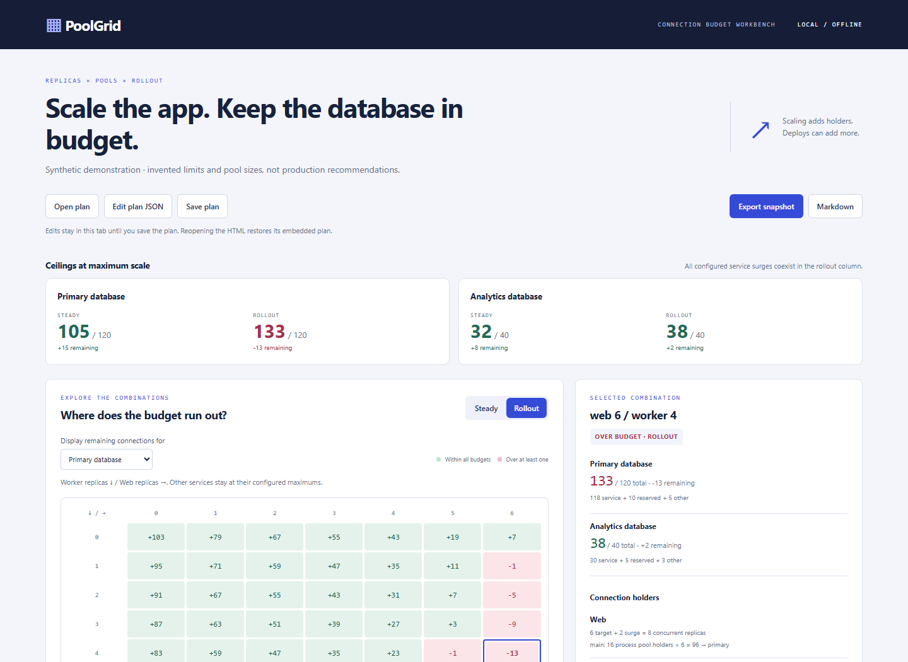

# PoolGrid

**See which replica combinations fit your database connection budget—even while a deployment overlaps.**

Six web replicas and four workers fit the synthetic example at steady state: **105 / 120** connections. Add the configured rollout overlap and the count becomes **133 / 120**. PoolGrid makes that boundary visible and shows every multiplication behind it.

[Download the offline workbench](https://github.com/4onv/poolgrid/releases/download/v0.1.0/poolgrid.html) · [Release files](https://github.com/4onv/poolgrid/releases/tag/v0.1.0) · [Model and format](docs/model.md) · [Research and alternatives](docs/research-2026-11-09.md)



*All limits, service names and pool sizes in the screenshot and bundled demo are synthetic. They are not production recommendations.*

## Try it in a minute

1. Download **[poolgrid.html](https://github.com/4onv/poolgrid/releases/download/v0.1.0/poolgrid.html)** and open it in Chromium or Firefox. No server, account or installation is needed.
2. Switch between **Steady** and **Rollout**. The top-right combination changes from within budget to over budget.
3. Select a matrix cell. Inspect replicas, extra replicas, pool holders and connection counts on the right.
4. Choose another resource to display its remaining budget. Cell color still checks **all** resources.
5. Use **Edit plan JSON** to enter your own assumptions, then **Save plan**. **Export snapshot** includes the applied plan, four scenarios and your selected combination. Markdown exports the four-scenario assumptions report.

The matrix varies two services. Every other service stays at its configured **maximum**. Current counts appear in the full scenario report; a matrix cell is not necessarily the actual current fleet.

The file contains its code and styles and makes no network requests. Changes stay in tab memory until you download the plan. Reopening the HTML restores its embedded plan; use **Open plan** to continue from saved JSON.

## What it counts

For each pool:

```text
concurrent replicas = target replicas + entered overlap allowance
pool holders        = concurrent replicas × processes per replica  (per-process pool)
pool holders        = concurrent replicas                          (per-replica pool)
pool connections    = pool holders × pool size
resource total      = sum of its pools + reserved + other clients
remaining           = resource limit − resource total
```

Steady state adds no overlap. Rollout adds each service's fixed extra replica count, or its percentage of target replicas rounded **up**. The model assumes those allowances coexist across services. A zero target has zero overlap in this model.

Use separate resources for separate limits. For example, pooler **client** connections and database **backend** connections are different quantities. PoolGrid does not infer multiplexing ratios, user/database pool-key combinations or framework settings.

## Install the CLI

Requires Node.js **22 or newer**. Download [4onv-poolgrid-0.1.0.tgz](https://github.com/4onv/poolgrid/releases/download/v0.1.0/4onv-poolgrid-0.1.0.tgz), then install the local archive:

```sh
npm install --global --offline --ignore-scripts ./4onv-poolgrid-0.1.0.tgz
poolgrid demo --out demo.html
poolgrid init --out plan.json
```

`init` copies the visibly synthetic example for editing. Replace its assumptions before using it for your deployment. No package registry publication is required; the archive has zero runtime dependencies and no install hooks.

```sh
poolgrid check plan.json --json
poolgrid check plan.json --phase steady
poolgrid matrix plan.json --phase rollout > matrix.json
poolgrid report plan.json --out workbench.html
poolgrid markdown plan.json --out assumptions.md
```

`check` evaluates every service at its configured maximum. It defaults to rollout and exits **1** if any entered resource budget is exceeded, **0** otherwise, or **2** for invalid input or an operational error. JSON includes `checkedScenario`, `status` and all four scenarios. `matrix` emits JSON for every combination. Other commands exit 0 on success. Output filenames must be new; files are not overwritten.

For source use, no dependency installation is required:

```sh
git clone https://github.com/4onv/poolgrid.git
cd poolgrid
node bin/poolgrid.js demo --out demo.html
```

## Use the library

Install the release archive in your project, then use the pure calculation API:

```js
import {validatePlan, analyzePlan, evaluateScenario, buildGrid} from '@4onv/poolgrid/core';

const plan = validatePlan(input);
const scenarios = analyzePlan(plan);
const selected = evaluateScenario(plan, {
  phase: 'rollout', replicas: {web: 3, worker: 2}
});
const grid = buildGrid(plan, {phase: 'rollout'});
```

`evaluateScenario` holds unmentioned services at their configured maximum. All functions return fresh data and leave the input unchanged. The main package entry also exports `renderPlan`, `toMarkdown` and the bounded strict `parseJson` reader. See [the complete model](docs/model.md).

## Where it fits

PoolGrid is a small planning workbench for a shared connection ceiling. The idea is established: [ConnBudget](https://github.com/buildyourownstuff/ConnBudget) already provides connection-capacity analysis, manifest ingestion and PostgreSQL/PgBouncer modeling. Use it when you want Compose, Kubernetes or ECS configuration discovery. PoolGrid's narrower contribution is an offline two-axis matrix, explicit holder arithmetic and portable editable plans. [Other calculators and the project comparison](docs/research-2026-11-09.md) describe substantial overlap.

## Limits

- It adds **entered ceilings**, not observed connections. It does not discover services, inspect a database, change infrastructure, load-test, predict latency or choose pool sizes.
- Within-budget means the arithmetic fits those assumptions. Performance and rollout reliability require separate validation.
- The overlap allowance must include every simultaneous holder you intend to cover. Kubernetes `maxSurge` alone may not bound terminating or draining pods; old/new pool-size differences, scale-down drains, failovers and staggered rollout timing are not modeled. Count additional clients explicitly or use a more appropriate scenario model.
- Zero-target services have no surge. Represent any still-draining connections separately; this is not a live controller simulation.
- Resource limits, reserves and outside clients are operator inputs. Missing clients remain missing. PoolGrid does not recommend provider plans or financial commitments.
- Plans support 1–4 resources, 2–8 services, 0–64 maximum replicas per service, 1–64 processes per replica and 1–8 pools per service. Full bounds are [documented](docs/model.md#bounds).
- Generated HTML and exported snapshots include entered plan contents. Review them before sharing. No credentials or connection strings are needed.

## Development

```sh
npm ci --ignore-scripts
npm test
npm run demo
npx playwright install chromium firefox
npm run test:browser
npm pack --ignore-scripts
npm run check:package
```

Tests cover independent matrix arithmetic, holder modes, overlap rounding, multiple resources, input limits, CLI exit codes, output preservation, exports and real Chromium/Firefox interaction. CI runs Node 22/24 on Windows/Ubuntu and both browsers; package jobs install the packed archive offline.

MIT licensed. [Issues](https://github.com/4onv/poolgrid/issues) with a small synthetic plan and expected arithmetic are welcome.
